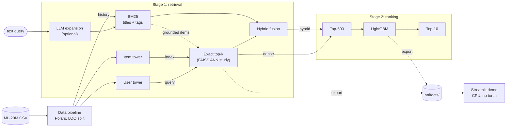

# ShopSage Recommender

Two-stage recommender on MovieLens-20M, being built as a production-style offline pipeline: a PyTorch Two-Tower retriever trained with in-batch and mixed negative sampling plus logQ correction, exact top-k retrieval with a FAISS ANN study, and a LightGBM re-ranker, measured against MostPop, EASE, BM25 and hybrid baselines with paired bootstrap confidence intervals. MovieLens-20M is a public stand-in for implicit-feedback e-commerce logs, with a rating ≥ 4.0 as the positive event.

**Status:** Day 1 of 10 — data pipeline, EDA and leave-one-out split done; Day 2 adds the as-of feature accessor, metrics and the MostPop / EASE baselines; model training starts Day 3.

<!-- Replace <your-github-handle> in the badges, clone URL, citation and pyproject.toml [project.urls] Homepage once the GitHub repo exists. -->

[](https://github.com/<your-github-handle>/shopsage-recommender/actions/workflows/ci.yml)
[](pyproject.toml)
[](LICENSE)
[](https://github.com/astral-sh/ruff)

## Results

MovieLens-20M, ranked against the full item catalogue with each user's known items masked (under leave-one-out, the history positives and every item the user rated before the cutoff; under the Liang protocol, the fold-in positives). The protocol is the one D-001 adopts on Day 4 (below); under leave-one-out Recall@50 equals HR@50, so one column carries both. Each cell will read `mean [95% CI]`, bootstrapped over test users; trained arms also report mean ± sd over ≥ 3 seeds (D-007). The rows fill from Day 2 (baselines) to Day 6 (ranker).

| Model | Recall@50 <sub>95% CI</sub> | NDCG@10 <sub>95% CI</sub> |
|---|:-:|:-:|
| MostPop (as-of popularity) | pending | pending |
| EASE ([Steck 2019](https://arxiv.org/abs/1905.03375)) | pending | pending |
| Two-Tower, round 1 (in-batch + logQ) | pending | pending |
| Two-Tower, round 2 (MNS: in-batch + uniform sampled negatives + logQ) | pending | pending |
| + LightGBM re-rank | pending | pending |

**Protocol (D-001, open; the owner's call on Day 4).** Under full-corpus leave-one-out on ML-20M, published with every rating as implicit feedback over 26,744 items (context, not like-for-like), the only non-sequential anchor is BPR-MF at HR@10 0.081 and HR@100 0.337 ([Klenitskiy & Vasilev 2023](https://arxiv.org/abs/2309.07602); [Petrov & Macdonald 2022](https://arxiv.org/abs/2207.07483)); BERT4Rec and SASRec variants reach HR@10 0.28–0.31 (Klenitskiy & Vasilev 2023), the strongest sequential models reach HR@50 0.550–0.615 ([Zhai et al. 2024](https://arxiv.org/abs/2402.17152)), and the best verified NDCG@10 is 0.211 (HSTU-large, same paper). No published model class reaches NDCG@10 0.32 under that protocol. Recall@50 0.42 is above the only non-sequential anchor quoted (BPR-MF, HR@100 0.337) in a non-comparable setup; in-repo EASE under `LOO-full` (P2-anchors, Day 2) shows whether a non-sequential model reaches it. Under the [Liang et al. 2018](https://arxiv.org/abs/1802.05814) strong-generalization protocol (held-out users, 20% of their positives as targets, Recall@K = hits / min(K, targets)), published Recall@50, all from its strict variant (`Liang-SG-strict`: held-out users are never trained on), runs from 0.235 (popularity; Steck 2019, Table 1) through 0.498 (WMF) and 0.521 (EASE; Steck 2019, Table 1) to 0.553 (RecVAE; Shenbin et al. 2020), and in its fold-in-in-training variant (`Liang-SG-fit`: the held-out users' fold-in 80% is in the training data) NDCG@10 is 0.302 for BPR-MF and 0.329 for EASE (Milogradskii et al. 2024, RecSys). The recommendation is to make `Liang-SG-strict` the headline (Recall@20/50, NDCG@100 and NDCG@10 with paired bootstrap CIs over users), because the Recall@50 anchors live there and the inductive user tower (D-004) scores users it never trained on, with NDCG@10 compared against the fit-variant anchors and that caveat stated; to keep this timestamp leave-one-out split as a secondary table; and to run MostPop and EASE in-repo under both variants as calibration anchors, each against its own variant's published figure (EASE: Recall@50 0.521 strict, NDCG@10 0.329 fit).

**Targets, not results.** The brief's Recall@50 0.42 → 0.58 and NDCG@10 0.32 are re-labelled: Recall@50 ≥ 0.42 for round 1 (plausible under `Liang-SG-strict`, the variant all the Recall@50 anchors above come from), 0.50–0.52 as a realistic stretch, and NDCG@10 0.32 as a stretch (EASE: 0.329 under `Liang-SG-fit`). 0.58 exceeds every published Liang-protocol Recall@50. Nothing is a result until measured.

## Architecture



- **Stage 1** scores the whole catalogue of 13,681 items. The item tower embeds `item_idx` plus genres, a year bucket, genome PCA-64 with a missing-genome flag and, optionally (first on the cut list), a BGE-M3 embedding of "title (year). genres. top genome tags". The user tower is open until Day 3 (D-004); the recommendation is an inductive MLP over the user's recent positives and behavioural features ([Design rationale](#design-rationale)). Retrieval is exact by default, with already-seen items set to −inf before the top-500 cut; FAISS IVF and HNSW indexes are benchmarked against it as an ANN study. BM25 over item text, optionally with an LLM-expanded query, is both a baseline and the second leg of hybrid retrieval.
- **Stage 2** re-ranks the 500 candidates with LightGBM LambdaRank, trained on a held-out subset of the validation users (V_B; D-006), and returns the Top-10.
- **Offline vs demo.** Everything heavy is precomputed; the demo loads exported artifacts and never imports torch.

## Quickstart (local)

Needs Python 3.11 or 3.12 and [uv](https://docs.astral.sh/uv/); no NVIDIA GPU.

```bash
uv sync --extra dev                  # Day 1: core + dev and EDA tools (no torch)
bash scripts/download_data.sh        # MovieLens-20M into data/raw/ml-20m
uv run shopsage prepare --config configs/data/movielens_20m.yaml
uv run shopsage stats --processed-dir data/processed
make eda                             # runs notebooks/01_eda.ipynb, which re-runs prepare (same split_sha256)
uv run pytest                        # unit + property-based tests
```

`prepare` writes the parquet artifacts, id mappings, splits and `splits/meta.json` to `data/processed/` (schemas in [docs/api_spec.md](docs/api_spec.md)); `stats` prints `meta.json`. The current tests run on small synthetic fixtures and need no download; the `slow` marker registered in `pyproject.toml` is reserved for future tests on the real data (deselect them with `-m "not slow"`).

**Local training (Apple silicon, MPS):** `uv sync --extra dev --extra train --extra cpu`. On macOS, run `brew install libomp` before importing LightGBM (the 4.7 wheel needs `libomp.dylib`). `uv sync` is exact, so name every extra in one command, and never combine `--extra cpu` with `--extra gpu`: both FAISS wheels install the same `faiss` package, so `pyproject.toml` declares the two extras as conflicting (likewise `demo` and `gpu`).

## Training on a cloud GPU

The laptop (Apple M5, 16 GB) runs the data pipeline, EDA, tests, the demo and a 30-epoch in-batch training smoke run on MPS (~44 min; E002). Batch sizes ≥ 8,192 and sampled negatives go to a rented Linux GPU (Modal A10G, RunPod, or a free Colab / Kaggle T4), set up with one command; the train step (`scripts/train.sh`, `shopsage train`) lands on Day 3.

```bash
git clone https://github.com/<your-github-handle>/shopsage-recommender.git
cd shopsage-recommender
export WANDB_API_KEY=...             # or WANDB_MODE=offline
bash scripts/bootstrap_cloud.sh      # uv sync --python 3.12 --extra train --extra gpu --extra llm, then download + prepare
```

On Linux, torch comes from the explicit index `https://download.pytorch.org/whl/cu126` (torch 2.14.1+cu126), so its CUDA runtime matches `faiss-gpu` (Meta's official CUDA 12.6 wheel, Linux x86_64 only) and works on drivers ≥ 525 (≥ 560 natively), as on Colab, Kaggle and RunPod T4 hosts; PyPI's default Linux wheel links CUDA 13 and needs driver ≥ 580. Blackwell GPUs (RTX 50xx, B200) need the cu130 index instead.

| GPU | B = 4,096 | B = 8,192 | B = 16,384 + 4,096 sampled negatives (worst case) |
|---|:-:|:-:|:-:|
| T4 16 GB | 1.4 GB / ~26 s | 2.5 GB / ~30 s | 6.1 GB / ~49 s |
| A10G 24 GB | 1.4 GB / ~12 s | 2.5 GB / ~16 s | 6.1 GB / ~26 s |
| RTX 3060 12 GB | 1.4 GB / ~20 s | 2.5 GB / ~27 s | 6.1 GB / ~46 s |
| RTX 4060 8 GB | 1.4 GB / ~25 s | 2.5 GB / ~34 s | 6.1 GB / ~57 s |
| Apple M5 16 GB, MPS (measured, E002) | 2.3 GB (K = 4,096; 1.2 GB in-batch) / 88 s (in-batch) | — | — |

Cells are peak memory / seconds per epoch for the Two-Tower (136,674 × 128 user and 13,681 × 128 item tables, in-batch softmax), with AMP on the CUDA rows; the M5 row ran bf16 autocast (E002). The GPU rows are an independent roofline estimate (±30%, with allocation-exact coefficients measured on the real model shapes); only the M5 row is measured, with synthetic tensors of the real shapes (E002), and the Day-3 smoke run re-measures it with the real training loop. **8 GB minimum, 16 GB or more recommended**; the A10G (24 GB) is the best value. Static memory is ~0.40 GB (parameters 78 MB, AdamW state 155 MB, in-GPU index tensors); logits at ~13 B per element at the backward peak (autocast keeps softmax and cross-entropy in fp32) are 0.22 / 0.87 / 4.36 GB of the three columns (1.4 / 2.5 / 6.1 GB); the remaining 0.78 / 1.23 / 1.34 GB is the non-logit term (gradients, tower activations including the ≤ 50-item history pooling, workspace), to be measured on Day 3. Evaluation is the easier way to run out of memory: a one-shot 136,674 × 13,681 fp32 score matrix is 7.5 GB, so scoring runs in chunks of ≤ 8,192 users. Training defaults: `AdamW(fused=True)` with no weight decay on the embedding tables; bf16 autocast when `torch.cuda.is_bf16_supported(including_emulation=False)` (compute capability ≥ 8.0), else fp16 with `GradScaler` (the T4 is sm_75 and has no native bf16); every off-diagonal in-batch column that is a train positive of the row's user is masked as an accidental hit (the row's own positive column never is): ~660 per row at B = 4,096 (row-weighted mean on the Day-1 train split; median 571, p90 1,298), ~4 of them duplicates of the row's own positive, because the top-100 movies are 23.5% of positives.

Other workloads: BGE-M3 (568M parameters: ~1.1 GB of weights in fp16, 2.3 GB fp32 checkpoint) embeds the 13,681 kept items ("title (year). genres. top genome tags") in ~1 min, mostly checkpoint load, and can run on the laptop. `Qwen/Qwen2.5-0.5B-Instruct` served by vLLM with `--gpu-memory-utilization 0.2 --max-model-len 4096 --enforce-eager` (`--dtype half` on the T4) reserves 0.2 × VRAM, ~3 GB on a T4 and ~4.5 GB on an A10G; never run it at vLLM defaults next to training. The LightGBM ranker is CPU-only: 20K users × 500 candidates ≈ 10M rows ≈ 2 GB of RAM, whereas all 136,674 users (68M rows, ~9.6–16 GB) do not fit the laptop.

**Budget (estimate).** A 30-epoch run at batch 4,096 is ~6 min on an A10G and ~13 min on a T4. With the 3-seed policy (ablation (a) = 5 arms × 3 seeds, plus smoke/tuning runs, data preparation and BGE-M3) plan on ~3 GPU-hours on an A10G (~\$3.5 on Modal at \$1.10/h) and budget 4–5 h (~\$5) with contingency; a T4 needs roughly twice the time (~\$5 at \$0.59/h; free on Kaggle or Colab). The plan covers one protocol; if D-001 adopts the Liang protocol, retraining ablation (a) on that split adds 15 runs ≈ 1.5 A10G-hours (~\$1.65) at the rate above. Logged W&B run times will replace these estimates.

## Repository layout

```text
shopsage-recommender/
├── configs/
│   ├── data/movielens_20m.yaml    # preprocessing + split knobs, snapshotted into meta.json
│   └── train/, deploy/            # Two-Tower / LightGBM (Day 3+) and demo (Day 9) configs
├── data/                          # raw/, processed/ (git-ignored); samples/README.md (licence)
├── docs/
│   ├── design.md                  # architecture, evaluation protocol, compute plan, decisions
│   ├── experiment_log.md          # dated runs with W&B links, decision log
│   ├── api_spec.md                # artifact schemas, metric definitions, Python API and CLI contract
│   └── figures/                   # EDA plots; demo GIF (Day 9)
├── notebooks/01_eda.ipynb         # EDA over the raw CSVs, then prepare (re-run) + DuckDB over the parquet
├── src/shopsage_rec/
│   ├── cli.py                     # Typer app behind the `shopsage` command
│   ├── config.py                  # DataConfig, SplitConfig, load_data_config
│   ├── data/                      # loader, preprocess, split, pipeline
│   ├── features/                  # as-of history accessor, user and item features (Day 2)
│   ├── models/                    # Two-Tower model and trainer (Days 3, 5)
│   ├── retrieval/                 # exact top-k, FAISS ANN study, BM25, hybrid fusion (Days 4, 7)
│   ├── ranking/                   # LightGBM re-ranker (Day 6)
│   ├── evaluation/                # HR@K, NDCG@10, MRR@10, paired bootstrap CIs (Day 2)
│   ├── llm/                       # LLM query expansion (Day 8)
│   └── serving/                   # Streamlit app.py + its generated requirements.txt (hello-world Day 2, demo Day 9)
├── tests/                         # pytest + hypothesis
├── scripts/                       # download, prepare, cloud bootstrap; train/eval/serve (Day 3+)
│   └── bench_two_tower_step.py    # Two-Tower training-step benchmark on synthetic ML-20M shapes (E002)
├── artifacts/                     # checkpoints, embeddings, FAISS index, LightGBM (git-ignored)
├── .github/workflows/ci.yml       # lint + tests; demo requirements.txt install check
├── .pre-commit-config.yaml        # ruff + hygiene hooks (make hooks)
├── .streamlit/                    # config.toml (demo settings); secrets.toml.example (template)
├── .dockerignore                  # allowlist for the Docker build context
├── Dockerfile                     # CPU image for the demo
├── LICENSE                        # MIT
├── Makefile                       # dev shortcuts (make eda, ...)
├── packages.txt                   # apt packages for Streamlit Cloud (libgomp1 for LightGBM)
├── pyproject.toml                 # package and extras: train, cpu, gpu, llm, demo, eda, dev
├── requirements.txt               # demo dependencies for the Dockerfile only
└── uv.lock                        # locked environment; with pyproject.toml the source of truth
```

The layout follows the author's standard project template. `retrieval/`, `ranking/` and `llm/` are additions that mirror the two-stage architecture, `pyproject.toml` replaces `setup.py`, and `serving/app.py` is a Streamlit entry point rather than a web service, because online serving is out of scope.

## Dataset

[MovieLens-20M](https://grouplens.org/datasets/movielens/20m/) from GroupLens; archive md5 `cd245b17a1ae2cc31bb14903e1204af3`.

| Field | Raw | After preprocessing (`splits/meta.json`) |
|---|---|---|
| Ratings | 20,000,263, 0.5–5.0 stars in half-star steps | 9,977,455 positives (rating ≥ 4.0) |
| Users | 138,493, each with ≥ 20 ratings; no demographics | 136,674 |
| Movies | 27,278 listed, 26,744 with at least one rating; title with year, pipe-separated genres | 13,681; density 0.5336% |
| Split | — | train 9,704,107; val 136,674; test 136,674 (one each per user) |
| Tags | 465,564 free-text tag applications; tag genome of 1,128 tags × 10,381 movies | kept raw; read only through the as-of accessor |
| Time span | 1995-01-09 to 2015-03-31 | — |

Preprocessing is configured in [`configs/data/movielens_20m.yaml`](configs/data/movielens_20m.yaml) and takes ~3 s (warm cache; ~9 s cold) at 2.3 GB peak RSS on the M5:

- **Positives.** A rating ≥ 4.0 is a positive, the [Liang et al. 2018](https://arxiv.org/abs/1802.05814) convention. `ratings.parquet` keeps all 20,000,263 raw ratings, so low ratings stay available as ranker features (never as labels).
- **Filtering.** Items with < 5 positives are dropped in a single pass, then users with < 5 positives. The item filter is this project's choice (D-002), so that every item ID embedding gets training signal; it is not an iterated 5-core (1 item ends below 5), the ML-20M leave-one-out papers cited above keep all 26,744 items, and Liang et al.'s released preprocessing applies none (`min_sc = 0`: 136,677 users, 20,720 items, 9,990,682 positives; 20,108 items after their user split). `min_item_interactions: 1` reproduces it and is used for the Liang-protocol variant.
- **Ids.** Contiguous `user_idx` / `item_idx`, ascending by `userId` / `movieId` (`mappings/*.parquet`). Release years are parsed from titles, including open and ranged forms such as "(2007-)" and "(1975-1979)" (first year).
- **Split.** Leave-one-out per user by timestamp: test = most recent positive, val = second most recent, train = the rest. Same-second ties are broken by a seeded splitmix64 hash of the raw ids (`(userId << 32) | movieId` mixed with `splitmix64(seed)`, seed 42), stored as a `UInt64` `tie_key` before id remapping and dropped from the split files. It never uses Polars' `Expr.hash`, which is not stable across Polars versions, and a golden test pins the exact val/test pairs of a fixed 20-row table; it replaces an earlier affine hash that favoured the higher of two adjacent item ids ~81% of the time. 20,580 users (15.06%) have their test and val events in the same second; `cold_test_items` = 0.
- **Stats.** `splits/meta.json` records the counts, the tie diagnostics (`users_with_boundary_tie`, `boundary_tie_fraction`, `users_with_val_train_tie`, `users_with_any_boundary_tie`), `cold_test_items`, `cold_val_items`, `split_sha256` (over the sorted val and test pairs) and `tie_break`, with the config snapshot and library versions; `shopsage stats` prints them.
- **Leakage guard.** `ratings.parquet` and `tags.parquet` are raw and unsafe for features: they contain the val/test positives, 36.7% of users have ratings after their test event, and 711 users tagged their own test movie. From Day 2 every feature goes through one as-of accessor, `features.asof.history(stage='val'|'test')`: positives from split membership, raw ratings and tags strictly before the user's cutoff, item statistics from train only, and candidate masking of everything rated before the cutoff, guarded by a leakage-canary test.

### EDA

Figures from [`notebooks/01_eda.ipynb`](notebooks/01_eda.ipynb), computed on the raw data:

- [Rating distribution](docs/figures/01_rating_distribution.png): 50.0% of ratings are ≥ 4 stars, the positive cut, and 4.0 is the most common value (28%).
- [User activity](docs/figures/02_user_activity.png): ratings per user are right-skewed, with median 68, p90 334 and max 9,254 (GroupLens sampled users with ≥ 20).
- [Item popularity](docs/figures/03_item_popularity_longtail.png): popularity is long-tailed (Gini 0.90 over 26,744 rated movies), with the top 1% of movies holding 33% of ratings and the top 10% holding 86%.
- [Genres](docs/figures/04_genre_distribution.png): counting a rating once per genre of its movie, Drama (8.9M), Comedy (7.5M), Action (5.6M) and Thriller (5.3M) dominate.

**Licence.** GroupLens permits research use; redistribution and commercial use need separate permission. This repository therefore ships no MovieLens files: `scripts/download_data.sh` fetches them from grouplens.org and `data/samples/` holds only a README. No endorsement by the University of Minnesota or GroupLens is implied. Publications using the data must cite:

> F. Maxwell Harper and Joseph A. Konstan. 2015. The MovieLens Datasets: History and Context. *ACM Transactions on Interactive Intelligent Systems (TiiS)* 5, 4, Article 19 (December 2015), 19 pages. https://doi.org/10.1145/2827872

## Experiments

Each arm changes only the factor named. Arms are compared with their reference by a paired bootstrap over users on the difference (same resample indices, 2,000 resamples, percentile 95% CIs, seeded numpy Generator), and every trained arm runs ≥ 3 seeds, reported as mean ± sd (D-007). A difference is claimed only if the paired user-bootstrap CI excludes 0 and the per-seed paired Δs (seed k of arm A vs seed k of arm B, same users) all have the CI's sign; tables also report the per-seed Δ range. Until D-001 closes, tables (a) and (b) are planned under leave-one-out, with and without the catalogue-as-of mask (`LOO-full`, `LOO-asof`); (c) uses its own tag-as-query benchmark, described below its table. Under leave-one-out Recall@K equals HitRate@K, so these tables report HR@K; the full readout is HR@{10, 50, 100, 500}, NDCG@10 and MRR@10, defined in [docs/api_spec.md](docs/api_spec.md). MostPop and EASE join every table as calibration rows (D-009); in (c) they ignore the query. Runs will be logged to Weights & Biases from Day 3 and summarised in [docs/experiment_log.md](docs/experiment_log.md).

**(a) Negatives: in-batch vs mixed negative sampling** (Day 5; D-005). Isolates the negative distribution and its correction; towers and features are fixed, every arm gets the same 30-epoch budget with the best epoch selected on V_A HR@50, and the temperature is tuned on V_A per arm.

| Training negatives | HR@50 | HR@500 | NDCG@10 |
|---|:-:|:-:|:-:|
| MostPop | pending | pending | pending |
| EASE | pending | pending | pending |
| In-batch softmax | pending | pending | pending |
| In-batch + logQ | pending | pending | pending |
| MNS + logQ: in-batch + M = 2,048 uniform sampled | pending | pending | pending |
| + mined hard negatives, round-1 ranks 101–500 (optional) | pending | pending | pending |
| Full softmax over 13,681 items | pending | pending | pending |

**(b) Retriever: dense vs BM25 vs hybrid** (Day 7; D-010). Isolates the candidate generator at a fixed budget of 500. BM25 item documents are `title_clean`, genres, top-k genome tags and train-period user tags (excluding the evaluated user's own); the query is the same fields from the user's last ≤ 20 as-of positives, scored as a scipy.sparse BM25 matrix product. The genome covers 74.4% of kept items and 99.2% of test events.

| Retriever | HR@50 | HR@500 | NDCG@10 |
|---|:-:|:-:|:-:|
| MostPop | pending | pending | pending |
| EASE | pending | pending | pending |
| BM25 | pending | pending | pending |
| Dense: Two-Tower, exact search | pending | pending | pending |
| Hybrid: RRF (k = 60) | pending | pending | pending |
| Hybrid: per-user z-scored convex mix, α tuned on V_A | pending | pending | pending |

**(c) LLM query expansion** (Day 8; D-010)

| Query path | HR@10 | HR@50 | Latency p50 / p95 | Cost per 1K queries |
|---|:-:|:-:|:-:|:-:|
| MostPop (query ignored) | pending | pending | pending | — |
| EASE (history only, query ignored) | pending | pending | pending | — |
| BM25 | pending | pending | pending | — |
| BM25 + LLM expansion (Claude Haiku) | pending | pending | pending | pending |
| Dense | pending | pending | pending | pending |
| Hybrid | pending | pending | pending | pending |

MovieLens has no queries and the brief's "offline CTR delta" cannot be measured offline, so this is tag-as-query known-item retrieval: ~2,000 (user, tag) query events, query = the tag text, relevant = the movies that user tagged with it, history as of the cutoff. Arms are compared by paired bootstrap, and the grounding rate of expansions is reported. Responses are cached by `sha256(model_id + prompt + params)`; `claude-haiku-5-5` rejects non-default sampling parameters, so the cache is what makes reruns reproducible. `Qwen/Qwen2.5-0.5B-Instruct` served by vLLM is documented as a self-hosted alternative.

## Demo

Planned for Day 9, after a hello-world deploy on Day 2: a Streamlit app (`src/shopsage_rec/serving/app.py`) in which a visitor picks 5 movies to build a profile and gets a Top-10 with retrieval score, LightGBM score and the retriever that surfaced each item, with toggles for dense / BM25 / hybrid retrieval and for LLM expansion (the expanded query is displayed). Example queries use precomputed expansions, and live LLM calls are capped per session. Demo GIF (`docs/figures/demo.gif`, Day 9) and live URL: pending.

<!--  -->

- **Host.** Streamlit Community Cloud: 690 MB of RAM guaranteed (up to 2.7 GB), at most 2 CPU cores, Python 3.12 by default, Debian 11, asleep after 12 h idle. Hugging Face Spaces and the CPU `Dockerfile` are fallbacks, both subject to D-003 (the Dockerfile keeps the image out of public registries until it is decided).
- **Dependencies (decided).** Community Cloud installs from the first dependency file it finds, searching the entrypoint's directory before the repo root, in the order `uv.lock` > `Pipfile` > `environment.yml` > `requirements.txt` > `pyproject.toml`, so the committed root `uv.lock` would win over a root `requirements.txt`. The app therefore gets `src/shopsage_rec/serving/requirements.txt`, generated by `uv export --frozen --no-hashes --no-emit-project --extra demo`, plus a two-line `sys.path` shim in `app.py`. The root `requirements.txt` serves the Dockerfile only, and the root `packages.txt` installs `libgomp1` for LightGBM.
- **Artifacts.** The app never imports torch or loads BGE-M3. Its artifacts are git-ignored and fetched at start-up from a versioned, sha256-pinned GitHub Release asset. Under the D-004 recommendation a visitor profile needs only the 13,681 × 128 item embeddings (~7 MB) and the user-tower MLP weights, run in ~15 lines of numpy, with no 70 MB user table. LLM expansion is grounded through BM25 (expanded query → matching items → mean item embedding → exact search).
- **Licence (D-003, open).** MovieLens may not be redistributed, so until GroupLens grants permission the public demo ships no per-user rating rows (hence visitor-built profiles) and downloads titles from GroupLens at start-up instead of bundling them.

## Design rationale

Full reasoning, rejected alternatives and the decision log (D-001 to D-012, each marked open or decided) are in [docs/design.md](docs/design.md) and [docs/experiment_log.md](docs/experiment_log.md).

- **Two-Tower retrieval.** User and item encoders are independent, so item vectors are computed once offline and retrieval becomes maximum-inner-product search, the standard shape of large-corpus candidate generation.
- **Inductive user tower (D-004, open, due Day 3).** ML-20M has no demographics. The recommendation is an MLP over mean-pooled item-tower embeddings of the user's last ≤ 50 as-of positives plus behavioural features (log activity, mean rating, genre affinity, recency), with the `user_id` embedding kept as an optional input under ID-dropout (0.3) and as an ablation arm. It works under leave-one-out, strong-generalization and temporal protocols and serves visitor profiles through the missing-feature path (design.md §7); their quality is not measured. It will carry a numpy-vs-torch parity test (1,000 users, max abs diff < 1e-5, no NaN).
- **Hard negatives as mixed negative sampling (D-005).** The brief's "hard-negative mining" round is mixed negative sampling (MNS, Yang et al. 2020): in-batch negatives plus M = 2,048 uniformly sampled negatives per batch, logQ over the mixed proposal `log(B·p_batch(j) + M·q(j))` with q(j) = 1/13,681, and accidental-hit masking of every off-diagonal column that is a train positive of the row's user (the row's own positive column is never masked; ~660 per row at B = 4,096; a 234 MB bitset, or sorted int64 keys). The sampler is uniform, not the smoothed-unigram popularity^0.75, because the latter barely reaches the tail: at B = 4,096 and M = 2,048 the bottom popularity tercile's share of negative columns is 11.5% under uniform, 1.0% under popularity^0.75 and 0.5% with in-batch negatives alone. Popularity counts and masks come from the train split only, and val/test items are never excluded from negatives, which would leak labels. In published work the loss matters more than the negatives (on ML-20M under full-corpus leave-one-out, BCE → sampled softmax moved SASRec's HR@50 from 0.447 to 0.549; Zhai et al. 2023, KDD), so full softmax, cheap at 13,681 items, is an arm of ablation (a).
- **Exact search, FAISS as a study (D-008).** Exact scoring of 13,681 × 128 vectors takes seconds on CPU, so it is the default: batched matmul → `masked_fill(M_u, −inf)` → `torch.topk` / `np.argpartition`, in chunks of ≤ 8,192 users, where `M_u` is the set of the user's seen items. Seen items are set to −inf before top-k: 1,293 users have > 500 train positives (max 3,148), so "top-500, then drop seen" would be a bug. `IndexFlatIP` gets the same result from one `search()` per user with `IDSelectorNot(IDSelectorBatch(M_u))`, or from k = 500 + `max_u |M_u|` per chunk followed by dropping the masked ids, which is equivalent to masking first. IVF and HNSW are reported as an ANN study (overlap@500 with exact, HR@500 delta, latency); embeddings are L2-normalised at export, with a unit-norm test.
- **LightGBM re-ranker (D-006).** Ranking 500 candidates is a tabular problem over heterogeneous features (retrieval score, popularity, genre and genome match, explicit low ratings); LambdaRank trees are strong, fast and CPU-only. Val users are split into disjoint halves by `val_partition.seed` = 42, the same split for every training seed: V_A (retriever selection: the best checkpoint by HR@50 within a fixed 30-epoch budget, temperature, hybrid α) and V_B (ranker labels, 10% held out for early stopping). Candidates are the retriever's Top-500 with as-of seen items masked and the val item as the only label 1; a group whose val item was missed is dropped and the drop rate (= 1 − V_B HR@500) logged, never patched by injecting the positive. The ranker trains on all 500 candidates per group (the test-time distribution) at a 20,000-user cap (10M rows ≈ 2 GB); if RAM is tight, the fallback is ranks 1–50 plus 50 random from 51–500 with row weight 9 on the random ones. At test, all 500 candidates are re-ranked with features as of the test cutoff, and end-to-end NDCG@10 / HR@10 over all test users (misses score 0) is reported next to NDCG@10 in retriever order; any number conditioned on a retrieval hit is labelled as such. Low ratings feed features only, never labels. Deep rankers (DIN, MMoE) are out of scope.
- **Baselines (D-009).** MostPop (as-of popularity) and EASE (Steck 2019) join every results table, with ItemKNN if time permits. EASE takes minutes on the laptop: its Gram matrix is 749 MB in fp32 at 13,681 items and the peak ~2.2 GB (G, its inverse and LAPACK's working copy), ~5 GB at the Liang protocol's 20,720 items, so XᵀX is built and inverted in float32. BM25 is a content baseline, not a CF one.
- **No torchrec.** ~150K embedding rows (136,674 users plus 13,681 items, 77 MB in fp32) fit on one GPU many times over; sharded embedding tables would add complexity for no gain.
- **Polars and DuckDB, not pandas.** 20M ratings with explicit Int32/Float32 dtypes stay compact on a 16 GB laptop, and the leave-one-out split is a few vectorised sort and window passes. DuckDB runs analytical SQL straight over the parquet files for EDA.
- **Uncertainty (D-007).** At n = 136,674 the bootstrap 95% CI half-width on HR@50 is only ~±0.27 percentage points, so training-seed variance is expected to dominate; under the Liang protocol (10,000 test users) the half-width is ~±1.0 point, so user sampling also matters. Arms are compared by paired bootstrap, every trained arm runs ≥ 3 seeds, and a difference is claimed only if the CI excludes 0 and every per-seed paired Δ has the CI's sign.

## Limitations

- **Global look-ahead.** Leave-one-out is per user, not a global time split: averaged over test users, 53.7% of train rows are newer than that user's test event, and at the median test event 56.8% of the kept catalogue had not yet received its first rating (Day-1 measurement; the leak is described by Ji et al., TOIS 2023). Leave-one-out results are therefore reported both with and without a catalogue-as-of mask (D-001). The genome scores and the global item filter are accepted, documented mild global leaks.
- **Session timestamps.** For 51.6% of users the whole positive history spans ≤ 1 hour (63.5% within a day), and 24.2% have a tie at some split boundary, so "most recent" mostly means "last rated in a sign-up session". The task is not framed as next-movie prediction: metrics are also split by tie / no-tie and by session span, and recency features rank behind popularity, genre, genome and history-similarity features (D-011).
- **Popularity bias.** Implicit positives are head-heavy (the top 100 movies hold 23.5% of positives), and accuracy metrics reward recommending them. logQ removes the in-batch sampling bias, which raises popular items' scores relative to uncorrected in-batch training (A0, the "In-batch softmax" arm of ablation (a)); it does not counter popularity bias, and neither does MNS, whose uniform negatives constrain tail-item scores but still target the full softmax. A0 vs A1 ("In-batch + logQ") by train-popularity tercile measures the shift. No debiasing or exposure objective is optimised; MostPop and popularity-stratified HR make the head-heaviness visible.
- **No demographics.** ML-20M has none (unlike ML-100K and ML-1M), so the user tower is built from behaviour and item embeddings (D-004).
- **Cold start is untested by the offline metrics.** Under leave-one-out every test user has training history and every test item appears in training (`cold_test_items` = 0); items with < 5 positives are filtered out and never recommended. Neither new items (they would need an item-side OOV row, which the tower does not have) nor visitor profiles are measured.
- **Diversity.** The objective is accuracy alone, with no diversity, novelty or calibration constraint on the Top-10.
- **Offline only.** No online serving, A/B test or latency budget; offline HR and NDCG are a proxy for user value, not a measurement of it.
- **Dataset ends in 2015.** Twenty years of ratings over a fixed catalogue; taste and catalogue drift after March 2015 are not represented.

## Roadmap

- [x] Day 1: data pipeline, scaffold, EDA, leave-one-out split
- [ ] Day 2: as-of feature accessor and leakage canary, user and item features, metrics and paired bootstrap, MostPop and EASE, BM25 item documents, hello-world Streamlit deploy
- [ ] Day 3: Two-Tower with in-batch softmax, W&B tracking; user-tower decision (D-004)
- [ ] Day 4: exact-search evaluation, FAISS ANN study, evaluation-protocol decision (D-001)
- [ ] Day 5: mixed negative sampling (the brief's hard-negative round), ablation (a)
- [ ] Day 6: LightGBM re-ranker, NDCG@10
- [ ] Day 7: BM25 and hybrid retrieval, ablation (b)
- [ ] Day 8: LLM query expansion, ablation (c)
- [ ] Day 9: Streamlit demo and deployment
- [ ] Day 10: results write-up, README, publish

Days 7 and 8 are swapped from the original plan so that BM25 exists before LLM expansion (D-012). Cut order if late: BGE-M3 (genome PCA-64 instead), mined hard negatives, hybrid tuning, the live LLM path, the cloud GPU (train on MPS).

## License and citation

Code is released under the [MIT License](LICENSE). MovieLens data is not covered by it and remains under the GroupLens terms above. Cite the project as below and the dataset as given in [Dataset](#dataset).

```bibtex
@software{zhao2026shopsage,
  author = {Zhao, Yi},
  title  = {{ShopSage Recommender: Two-Tower Retrieval and LightGBM Re-ranking on MovieLens-20M}},
  year   = {2026},
  url    = {https://github.com/<your-github-handle>/shopsage-recommender}
}
```
