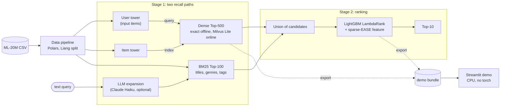

# ShopSage Recommender

Two-stage recommender on MovieLens-20M, built as a production-style offline pipeline. A PyTorch Two-Tower retriever and a BM25 retriever generate candidates, a LightGBM LambdaRank model re-ranks them, Milvus Lite serves both recall paths (dense, sparse and RRF hybrid search) in a CPU-only Streamlit demo, and Claude Haiku optionally expands free-text queries. Everything is measured under the strong-generalisation protocol of [Liang et al. (2018)](https://arxiv.org/abs/1802.05814) against MostPop and EASE, with bootstrap confidence intervals. MovieLens-20M stands in for implicit-feedback e-commerce logs, with a rating ≥ 4.0 as the positive event.

**Status:** S1 done (2026-10-23): the Liang split, the evaluation code and the MostPop and EASE baselines, which reproduce their published numbers. S2–S4 done (2026-10-24): the Two-Tower, trained in one Modal sweep, beats EASE; BM25 and the RRF hybrid are measured; the Milvus Lite serving index returns exactly the offline results; the LightGBM re-ranker lifts the system to Recall@50 0.542 and NDCG@10 0.343 (+0.021 and +0.015 over EASE) at 8.6 ms p95 on a laptop CPU. Claude Haiku query expansion helps BM25 when routed to unknown tags (E010). Next: the demo (S6). Plan and progress: [docs/plan.md](docs/plan.md) ([中文](docs/plan.zh-CN.md)).

[](https://github.com/createrW/shopsage-recommender/actions/workflows/ci.yml)
[](pyproject.toml)
[](LICENSE)
[](https://github.com/astral-sh/ruff)

## Results

Protocol `Liang-SG-strict`: 10,000 test users who are never seen in training. For each of them a random 20% of their positives are held out as targets and the other 80% are the input. Every one of the 20,108 catalogue items is ranked, with the user's input items excluded. Recall@50 is truncated (hits / min(50, number of targets)). Cells read mean [95% CI], bootstrapped over the test users; trained models report mean ± sd over 3 seeds. The Two-Tower (A1) beats EASE by +0.0151 [+0.0119, +0.0184] Recall@50 (paired); mined hard negatives do not help (A3 − A1 = −0.0020 [−0.0033, −0.0007]); the logQ correction is worth +0.225 (E007).

| Model | Recall@50 <sub>95% CI</sub> | NDCG@10 <sub>95% CI</sub> | Run |
|---|:-:|:-:|:-:|
| MostPop | 0.2352 [0.2310, 0.2396] | 0.1275 [0.1241, 0.1311] | E004 |
| EASE ([Steck 2019](https://arxiv.org/abs/1905.03375)), λ = 1,000 | 0.5210 [0.5156, 0.5264] | 0.3280 [0.3231, 0.3331] | E004 |
| BM25 over item text | 0.2529 [0.2489, 0.2571] | 0.1556 [0.1520, 0.1594] | E008 |
| Two-Tower, in-batch + logQ (A1), 3 seeds | 0.5361 ± 0.0005 (seed 42: [0.5306, 0.5417]) | 0.3351 ± 0.0005 (seed 42: [0.3304, 0.3405]) | E007 |
| Two-Tower + mined hard negatives (A3), 3 seeds | 0.5341 ± 0.0008 | 0.3351 ± 0.0011 | E007 |
| Hybrid: Two-Tower + BM25, RRF, 3 seeds | 0.4647 ± 0.0002 | 0.2789 ± 0.0007 | E008 |
| **+ LightGBM re-ranker** (dense top-500 ∪ BM25 top-100), 3 seeds | **0.5420 ± 0.0006** [0.5365, 0.5474] | **0.3428 ± 0.0000** [0.3378, 0.3478] | E009 |

**Calibration.** Both baselines reproduce their published figures under the same protocol (Steck 2019, Table 1): popularity Recall@50 0.235 and EASE 0.521, with Recall@20 and NDCG@100 also within 0.002. The split and the metric code therefore agree with the literature ([experiment log](docs/experiment_log.md), E004).

**Targets, and where they stand:**

- **Recall@50 ≥ 0.55: not met.** The system reaches 0.542 (E009). The highest published figure under this protocol is RecVAE's 0.553, and EASE scores 0.521.
- **NDCG@10 ≥ 0.32 after the ranker: met.** The system scores 0.343 and beats EASE (0.328) by +0.015 [+0.013, +0.017] (E009).
- **≤ 200 ms p95 for retrieval plus ranking on the demo host:** 8.6 ms p95 on a laptop CPU through exact numpy / scipy retrieval (E009); the host is measured in S6.
- **A hard-negative mining gain of +0.08 Recall@50: not met.** Mined negatives change Recall@50 by −0.002 [−0.003, −0.001] against in-batch + logQ; the logQ correction itself is worth +0.225 (E007).

Each is reported as measured, met or not.

## Architecture



- **Stage 1: two recall paths.**
  - The item tower embeds `item_idx`, genres, a year bucket and genome PCA-64.
  - The user tower is inductive: an MLP over the mean of history-item embeddings of the user's input items. It therefore serves users never seen in training, and visitor profiles in the demo.
  - Dense candidates come from an exact top-500 offline, with input items excluded before the cut, and from Milvus Lite online.
  - BM25 over titles, genres, genome tags and training users' tags adds 100 more.
- **Stage 2: ranking.** LightGBM LambdaRank re-ranks the union with about 11 features (both retrieval scores and ranks, a sparse-EASE score, popularity, genre and genome similarity) and returns the Top-10.
- **Offline vs demo.** Training runs on a cloud GPU. The demo loads exported artifacts, builds its Milvus Lite collection at startup and never imports torch.

## Quickstart (local)

Needs Python 3.11 or 3.12 and [uv](https://docs.astral.sh/uv/); no NVIDIA GPU.

```bash
uv sync --extra dev                  # core + dev tools (no torch)
bash scripts/download_data.sh        # MovieLens-20M into data/raw/ml-20m (md5-checked)
uv run shopsage prepare              # the Liang split into data/processed/liang (about 5 s)
uv run shopsage stats                # its meta.json
uv run shopsage evaluate             # MostPop and EASE with CIs (about 3.5 min on an M5)
uv run pytest                        # unit, property-based and real-data tests
```

- **Day-1 split and EDA.** `shopsage prepare --config configs/data/movielens_20m.yaml` builds the Day-1 leave-one-out split in `data/processed/`. `make eda` re-runs the EDA notebook on it.
- **Tests.** Tests marked `slow` need the downloaded data (deselect them with `-m "not slow"`).
- **Local training.** `uv sync --extra dev --extra train` adds torch (MPS on Apple silicon). On macOS, run `brew install libomp` before importing LightGBM.
- **Artifact schemas.** In [docs/api_spec.md](docs/api_spec.md).

## Training on a cloud GPU

Following the project's hosting plan, the Two-Tower trains on a rented GPU: Modal's A10, or RunPod as the cheaper alternative. The laptop (Apple M5, 16 GB) handles the data, the baselines, tests, the ranker and the demo.

**Modal (one command, runs in parallel):**

```bash
uv tool install modal && modal setup
modal secret create wandb WANDB_API_KEY=...          # or WANDB_MODE=offline
modal run scripts/modal_train.py                     # data prep, τ/lr check, arms A0–A4, mining, A3
modal volume get shopsage-data artifacts/runs artifacts/
```

**Any Linux GPU box (sequential):**

```bash
git clone https://github.com/createrW/shopsage-recommender.git
cd shopsage-recommender
export WANDB_API_KEY=...             # or WANDB_MODE=offline
bash scripts/bootstrap_cloud.sh      # uv sync --extra train --extra llm, then download + the Liang split
bash scripts/train.sh --sweep        # or: bash scripts/train.sh --one --arm A1 --seed 42
```

On Linux, torch comes from the explicit index `https://download.pytorch.org/whl/cu126` (torch 2.14.1+cu126). It works on NVIDIA drivers ≥ 525 (≥ 560 natively), as on Colab, Kaggle, RunPod and Modal hosts. Blackwell GPUs (RTX 50xx, B200) need the cu130 index instead.

| Arm (B = 4,096) | Peak memory, M5 MPS (measured, E006) | s / epoch, M5 MPS (measured, E006) |
|---|:-:|:-:|
| A1, in-batch + logQ | 2.1 GB | 129–146 |
| A2, + 2,048 uniform negatives | 2.2 GB | ~150 (10% of users, scaled) |
| A4, full softmax | 5.0 GB | ~420 (10% of users, scaled) |

- **VRAM requirement.** **8 GB minimum, 16 GB or more recommended**; a 24 GB A10 is the default. MPS reports the driver's allocation, an upper bound on CUDA's figure; each run's `metrics.json` records the measured GPU peak.
- **Precision.** bf16 autocast runs when `torch.cuda.is_bf16_supported(including_emulation=False)` (compute capability ≥ 8.0), else fp16 with `GradScaler` (the T4 is sm_75).
- **Masking.** Accidental hits (other columns that are positives of the row's user) are masked.

**Budget (estimate).** One sweep: 9 runs of 30 epochs (about 6 min each on an A10) plus a 4-run τ/lr check comes to about 1–1.5 A10-hours, ≈ \$1.1–1.7 at Modal's \$1.10/h. That is inside Modal's \$30 monthly Starter credit; budget 3 hours. W&B logs will replace these estimates. LightGBM is CPU-only: V_B's 5,000 users × ~600 candidates is about 3M rows.

## Repository layout

```text
shopsage-recommender/
├── configs/
│   ├── data/                      # movielens_20m_liang.yaml (headline), movielens_20m.yaml (Day-1 split)
│   └── train/, deploy/            # LightGBM draft (S4) and the demo config (S6)
├── data/                          # raw/, processed/ (git-ignored); samples/README.md (licence)
├── docs/
│   ├── plan.md, plan.zh-CN.md     # plan and status: done, not done, cloud deployment (EN / 中文)
│   ├── memory.md, memory.zh-CN.md # project memory: facts, rules, decisions (EN / 中文)
│   ├── experiment_log.md          # protocols, targets, decisions, runs (E001-E004)
│   ├── design.md                  # Day-1 technical design (partly superseded, see its banner)
│   ├── api_spec.md                # artifact schemas, metric definitions, CLI contract
│   └── figures/                   # EDA plots; demo GIF (S6)
├── notebooks/01_eda.ipynb         # EDA over the raw CSVs, on the Day-1 split
├── src/shopsage_rec/
│   ├── cli.py                     # Typer app behind `shopsage`: prepare, stats, evaluate
│   ├── config.py                  # DataConfig, SplitConfig (leave_one_out | liang)
│   ├── data/                      # loader, preprocess, split (leave-one-out), liang, pipeline
│   ├── evaluation/                # masked top-k, Recall/NDCG/HR, bootstrap, the evaluate runner
│   ├── models/                    # MostPop and EASE (S1); Two-Tower, losses, trainer, mining, sweep (S2)
│   ├── retrieval/                 # BM25, RRF fusion, Milvus Lite store (S3)
│   ├── ranking/                   # LightGBM re-ranker (S4)
│   ├── llm/                       # Claude Haiku query expansion (S5)
│   └── serving/                   # Streamlit app.py (deployment probe now, demo in S6) + requirements.txt
├── tests/                         # pytest + hypothesis
├── scripts/                       # download, prepare, cloud bootstrap, step benchmark; train.sh, modal_train.py (S2)
├── artifacts/                     # eval runs, checkpoints, demo bundle (git-ignored)
├── .github/workflows/ci.yml       # lint, types, tests; demo requirements + Milvus Lite probe on Linux
├── Dockerfile                     # CPU image for the demo (Hugging Face Spaces fallback)
├── Makefile                       # dev shortcuts (make help)
├── packages.txt                   # apt packages for Streamlit Cloud (libgomp1 for LightGBM)
├── pyproject.toml, uv.lock        # package, extras (train, llm, demo, eda, dev), locked environment
└── requirements.txt               # demo dependencies for the Dockerfile only
```

The layout follows the author's standard project template. `retrieval/`, `ranking/` and `llm/` are additions that mirror the two-stage architecture, `pyproject.toml` replaces `setup.py`, and `serving/app.py` is a Streamlit entry point rather than a web service, because online serving is out of scope.

## Dataset

[MovieLens-20M](https://grouplens.org/datasets/movielens/20m/) from GroupLens; archive md5 `cd245b17a1ae2cc31bb14903e1204af3`. Raw: 20,000,263 ratings (0.5–5.0 stars in half-star steps) from 138,493 users (each with ≥ 20 ratings; no demographics), 27,278 movies (26,744 rated), 465,564 tag applications and a tag genome of 1,128 tags × 10,381 movies, from 1995-01-09 to 2015-03-31.

**The Liang split** ([`configs/data/movielens_20m_liang.yaml`](configs/data/movielens_20m_liang.yaml), `src/shopsage_rec/data/liang.py`) replicates the authors' released preprocessing call for call. Ratings ≥ 4.0 are positives and users need at least 5 of them; there is no item filter. Users are permuted with numpy's legacy `RandomState(98765)`, and the last 20,000 become 10,000 validation and 10,000 test users. Their items are limited to the training catalogue, and for each held-out user with ≥ 5 items, `int(0.2 × n)` items are drawn as targets. It takes 5 s at 2.2 GB peak RSS on the M5.

| Quantity | This repo | Published |
|---|---|---|
| Positives | 9,990,682 | 9,990,682 |
| Users / movies before the split | 136,677 / 20,720 | 136,677 / 20,720 |
| Training users / training catalogue | 116,677 / 20,108 items | 20,108 items |
| Validation fold-in / targets | 589,887 / 142,514 | — |
| Test fold-in / targets | 579,008 / 139,775 | — |

**Leakage rules.** Item statistics, BM25 tags and every trained model use training users only. A held-out user's vector and features come from their input items only. `ratings.parquet` and `tags.parquet` stay raw and are never read for a held-out user's targets.

**The Day-1 split** (`configs/data/movielens_20m.yaml`, experiment_log E001) is a leave-one-out split by timestamp with a seeded splitmix64 tie-break. It is kept, but is not used for results since the 2026-10-23 re-plan.

### EDA

Figures from [`notebooks/01_eda.ipynb`](notebooks/01_eda.ipynb), computed on the raw data:

- [Rating distribution](docs/figures/01_rating_distribution.png): 50.0% of ratings are ≥ 4 stars, the positive cut, and 4.0 is the most common value (28%).
- [User activity](docs/figures/02_user_activity.png): ratings per user are right-skewed, with median 68, p90 334 and max 9,254 (GroupLens sampled users with ≥ 20).
- [Item popularity](docs/figures/03_item_popularity_longtail.png): popularity is long-tailed (Gini 0.90 over 26,744 rated movies), with the top 1% of movies holding 33% of ratings and the top 10% holding 86%.
- [Genres](docs/figures/04_genre_distribution.png): counting a rating once per genre of its movie, Drama (8.9M), Comedy (7.5M), Action (5.6M) and Thriller (5.3M) dominate.

**Licence.** GroupLens permits research use; redistribution and commercial use need separate permission. This repository therefore ships no MovieLens files: `scripts/download_data.sh` fetches them from grouplens.org and `data/samples/` holds only a README. No endorsement by the University of Minnesota or GroupLens is implied. Publications using the data must cite:

> F. Maxwell Harper and Joseph A. Konstan. 2015. The MovieLens Datasets: History and Context. *ACM Transactions on Interactive Intelligent Systems (TiiS)* 5, 4, Article 19 (December 2015), 19 pages. https://doi.org/10.1145/2827872

## Experiments

All under `Liang-SG-strict` on the 10,000 test users, with selection on V_A (half of the validation users). Arms are compared by a paired bootstrap over users on the difference (2,000 resamples). An arm in a claimed comparison runs 3 seeds, and a difference is claimed only if the paired CI excludes 0 and every per-seed difference has its sign. Context arms run one seed and are labelled. The planned run matrix and every logged run are in [docs/experiment_log.md](docs/experiment_log.md).

- **(a) Hard-negative mining** (S2–S3).
  - The reference is A1 (in-batch softmax + logQ correction).
  - Against it: A3, which adds per-row negatives mined from ranks 101–500 of A1's model, 3 seeds each.
  - Context arms: A0 (no logQ), A2 (2,048 uniform sampled negatives, i.e. mixed negative sampling) and A4 (full softmax over 20,108 items).
- **(b) Recall paths** (S3, E008). BM25 alone, the dense Two-Tower, and their RRF hybrid, next to MostPop and EASE. BM25 over item text barely beats popularity (0.253 vs 0.235 Recall@50), and fusing it at equal weight costs the dense path 0.072 (paired CI [−0.075, −0.069]). Text describes what a movie is, not who watches it. Milvus Lite returns exactly the offline answers on all three paths, and on the laptop exact numpy / scipy search is 16–40× faster.
- **(c) LLM query expansion** (S5, E010).
  - Setup: tag-as-query known-item retrieval over 1,000 (user, tag) events of held-out users, whose tags never enter the item documents.
  - Arms: BM25 on the raw tag vs BM25 on Claude Haiku's expansion.
  - Measures: grounding rate, latency and cost per 1,000 queries.
  - Why: MovieLens has no queries, and an offline "CTR delta" cannot be measured.
  - Result: expanding every query hurts, −0.031 [−0.057, −0.004] HR@50. When the tag is already a document term, extra terms dilute it. When the tag is unknown to the documents, expansion lifts HR@50 from 0.05 to about 0.25.
  - Routing expansion to unknown tags only gives **+0.022 [+0.012, +0.032] HR@50 on 1,000 fresh events**, at $0.14 per 1,000 calls and 1.7 s p50 per call.

## Demo

The S1 deployment probe is live in `src/shopsage_rec/serving/app.py`. It builds a Milvus Lite collection the size of the catalogue (20,108 items with 128-d dense and sparse vectors, synthetic data) and times dense, sparse and RRF hybrid search. On the laptop, Streamlit and the app together peaked at 451 MB, with hybrid search at p50 30 ms and p95 44 ms (E004). The S6 demo replaces it:

- **What it does.** A visitor picks 5 movies and gets a Top-10, showing the scores and the path that retrieved each item. A toggle switches between dense, BM25 and hybrid retrieval, and a free-text query box shows the LLM expansion.
- **Host.** Streamlit Community Cloud: 690 MB of RAM guaranteed (up to 2.7 GB), at most 2 CPU cores, Python 3.12, Debian 11, asleep after 12 h idle. Hugging Face Spaces and the CPU `Dockerfile` are fallbacks.
- **Dependencies.** Community Cloud reads `src/shopsage_rec/serving/requirements.txt` (from `uv export --extra demo`). It searches the entrypoint's directory before the repo root, where `uv.lock` would otherwise win. The root `packages.txt` installs `libgomp1` for LightGBM.
- **Artifacts.** The app never imports torch. Its bundle (item embeddings, user-tower weights, sparse EASE, BM25 weights, the LightGBM model) is fetched at startup from a sha256-pinned GitHub Release asset. The Milvus Lite collection is built and flushed at startup.
- **Licence (D-003, open).** MovieLens may not be redistributed. Until GroupLens grants permission, the public demo ships no per-user rating rows (hence visitor-built profiles) and obtains movie titles from GroupLens at startup.

<!--  -->

## Design rationale

The decision log (D-001 to D-014) is in [docs/experiment_log.md](docs/experiment_log.md) and [docs/memory.md](docs/memory.md); the plan's efficiency-first choices are in [docs/plan.md](docs/plan.md) §3.

- **The Liang protocol (D-001).** Held-out users who are never trained on, with a random 20% of their positives as targets, is the protocol behind the ML-20M Recall@50 anchors (popularity 0.235, EASE 0.521, RecVAE 0.553). It gives the targets a meaning, and in-repo MostPop and EASE reproduce those anchors exactly (E004).
- **Two-Tower retrieval with an inductive user tower (D-004).** User and item encoders are independent, so item vectors are computed once offline and retrieval is maximum-inner-product search. Because the user tower reads the user's input items rather than a user-ID row, it scores held-out users and demo visitors alike.
- **Hard-negative mining (D-005).**
  - In-batch softmax with logQ correction (Yi et al. 2019) is the reference.
  - The ablation adds negatives mined from each user's ranks 101–500 under the reference model, mixed with in-batch ones rather than used alone (Huang et al. 2020).
  - Uniform mixed negative sampling (Yang et al. 2020) and the full softmax, cheap at 20,108 items, are context arms.
- **Exact search offline, Milvus Lite online (D-008).** Exact scoring of 20,108 × 128 vectors takes milliseconds, so evaluation is exact, with input items set to −inf before the top-k cut. The demo serves both recall paths from Milvus Lite (FLAT index, dense and sparse fields, RRF hybrid search), which is parity-tested against the exact path.
- **BM25 as the second recall path (D-010).** BM25 is in-process: a scipy.sparse matrix offline and Milvus sparse vectors online, with the same weights. Elasticsearch would add a JVM service that Streamlit Cloud cannot host.
- **LightGBM re-ranker (D-006).** Ranking ~600 candidates is a tabular problem over heterogeneous features, and LambdaRank trees are strong, fast and CPU-only. The ranker trains on V_B, the half of the validation users not used for model selection, and a sparse-EASE score is one of its features. It is reported with and without that feature.
- **Uncertainty (D-007).** At 10,000 test users the bootstrap half-width on Recall@50 is about ±0.005 (E004). Arms are compared by paired bootstrap, and seed variance is reported for trained arms.
- **No torchrec, Polars and DuckDB.** About 20,000 item rows fit on one GPU many times over. Polars keeps the 20M-row tables compact on a 16 GB laptop, and DuckDB runs SQL straight over the parquet files.

## Limitations

- **No temporal realism.** The Liang protocol holds out a random 20% of each user's items, not their most recent ones, so the task is "complete a profile", not "predict what comes next". The tag genome is computed by GroupLens over all users, a documented mild global leak.
- **Popularity bias.** Implicit positives are head-heavy (the top 100 movies hold 23.5% of positives), and accuracy metrics reward recommending them. logQ removes the in-batch sampling bias; it does not counter popularity bias, and no debiasing or exposure objective is optimised.
- **No demographics.** ML-20M has none, so the user tower is built from item embeddings of the user's history (D-004).
- **Cold start.** Held-out users are new to the model, but every evaluated item has training positives, so new items are untested. Visitor profiles in the demo use the same inductive path, but their quality is not measured.
- **Diversity.** The objective is accuracy alone, with no diversity, novelty or calibration constraint on the Top-10.
- **Offline only.** No online serving or A/B test. Offline Recall and NDCG are a proxy for user value, not a measurement of it.
- **Dataset ends in 2015.** Twenty years of ratings over a fixed catalogue; taste and catalogue drift after March 2015 are not represented.

## Roadmap

- [x] S0 (Day 1): data pipeline, scaffold, EDA, the Day-1 split
- [x] S1: Liang split, evaluation code, MostPop and EASE calibrated (E004), Milvus Lite deployment probe
- [x] S2: Two-Tower with in-batch, uniform and mined negatives; one Modal training sweep (E007)
- [x] S3: BM25 path, Milvus Lite serving index, ablations (a) and (b) (E007, E008)
- [x] S4: LightGBM re-ranker over both recall paths (E009)
- [x] S5: Claude Haiku query expansion, ablation (c) (E010)
- [ ] S6: the Streamlit demo on Community Cloud
- [ ] S7: write-up and publish

Each step's tasks, owners and exit checks are in [docs/plan.md](docs/plan.md) ([中文](docs/plan.zh-CN.md)), and the project memory is in [docs/memory.md](docs/memory.md) ([中文](docs/memory.zh-CN.md)).

## License and citation

Code is released under the [MIT License](LICENSE). MovieLens data is not covered by it and remains under the GroupLens terms above. Cite the project as below and the dataset as given in [Dataset](#dataset).

```bibtex
@software{zhao2026shopsage,
  author = {Zhao, Yi},
  title  = {{ShopSage Recommender: Two-Tower Retrieval and LightGBM Re-ranking on MovieLens-20M}},
  year   = {2026},
  url    = {https://github.com/createrW/shopsage-recommender}
}
```
